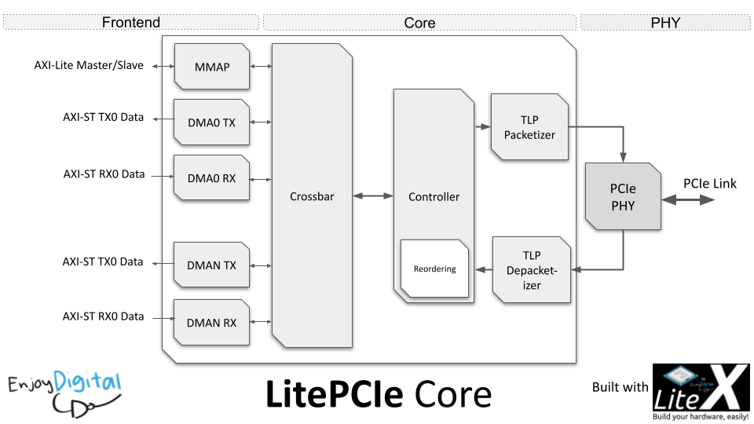

```
                                  __   _ __      ___  _________
                                 / /  (_) /____ / _ \/ ___/  _/__
                                / /__/ / __/ -_) ___/ /___/ // -_)
                               /____/_/\__/\__/_/   \___/___/\__/

                               Copyright 2015-2024 / EnjoyDigital

                            A small footprint and configurable PCIe core
                                     powered by Migen & LiteX
```

[](https://github.com/enjoy-digital/litepcie/actions)  [](https://deepwiki.com/enjoy-digital/litepcie)


[> Intro
--------
LitePCIe provides a small footprint and configurable PCIe core.

LitePCIe is part of LiteX libraries whose aims are to lower entry level of
complex FPGA cores by providing simple, elegant and efficient implementations
of components used in today's SoC such as Ethernet, SATA, PCIe, SDRAM Controller...

Using Migen to describe the HDL allows the core to be highly and easily configurable.

LitePCIe can be used as LiteX library or can be integrated with your standard
design flow by generating the verilog rtl that you will use as a standard core.

<p align="center"></p>

[> Features
-----------
PHY:
  - Xilinx Ultrascale(+) (up to PCIe Gen3 X16).
  - Xilinx 7-Series (up to PCIe Gen2 X8).
  - Intel Cyclone5  (up to PCIe Gen2 X4).
  - Intel Stratix5   (up to PCIe Gen2 X8).
  - Soft PHY on FPGA transceivers through LiteICLink (work in progress, [doc/softphy.md](doc/softphy.md)).
  - 64/128/256/512-bit datapath.
  - Clock domain crossing.

Core:
  - TLP layer.
  - Reordering.
  - MSI (Single, Multi-vector)/MSI-X.
  - Crossbar.

Frontend:
  - DMA (with Scatter-Gather).
  - MMAP (AXI/Wishbone Slave/Master).
  - PTM on Xilinx 7-Series, with experimental multi-lane and UltraScale+ Gen2/Gen3/Gen4 support ([integration](doc/manual/06_ptm.md)).

Software:
  - Linux Driver (MMAP and DMA).

[> FPGA Proven
---------------
LitePCIe is already used in commercial and open-source designs:
- 3G-SDI Capture/Playback board: http://www.enjoy-digital.fr/experience/pcie_3g_sdi.jpg
- SDR MIMO 2x2 board: https://www.amarisoft.com/products-lte-ue-ots-sdr-pcie/#sdr
- SDR MIMO 4x4 board: http://www.enjoy-digital.fr/experience/pcie_ad937x.jpg
- SDR CPRI board: http://www.enjoy-digital.fr/experience/pcie_sfp.jpg
- and others commercial designs...

[> Possible improvements
------------------------
- add standardized interfaces (AXI, Avalon-ST)
- add Lattice support
- ... See below Support and consulting :)

If you want to support these features, please contact us at florent [AT]
enjoy-digital.fr.

[> Documentation
----------------
The **PCI Express Core & PHYs manual** is the reference of LitePCIe: a nightly
[PDF](https://github.com/enjoy-digital/litepcie/releases/download/manual-nightly/litepcie_manual.pdf)
and [HTML page](https://github.com/enjoy-digital/litepcie/releases/download/manual-nightly/litepcie_manual.html)
are published on the [manual-nightly](https://github.com/enjoy-digital/litepcie/releases/tag/manual-nightly)
release. Sources in [doc/manual](doc/manual/README.md) (build: `python3 doc/manual/build.py`, outputs in
`build/doc/`):

- **Understand**: [introduction](doc/manual/01_introduction.md), [PCI Express in a nutshell](doc/manual/02_pcie_primer.md).
- **The core**: [architecture](doc/manual/03_core_architecture.md), [scatter-gather DMA](doc/manual/04_dma.md),
  [memory-mapped bridges and interrupts](doc/manual/05_mmap_irq.md), [PTM](doc/manual/06_ptm.md).
- **The PHYs**: [hard-IP PHYs](doc/manual/07_hard_phys.md), [soft PHY](doc/manual/08_soft_phy.md) (in development,
  detailed notes in [doc/softphy.md](doc/softphy.md)).
- **Use it**: [supported FPGAs and boards](doc/manual/10_boards.md), [getting started](doc/manual/11_getting_started.md),
  [integration](doc/manual/12_integration.md), [Linux driver and tools](doc/manual/13_software.md),
  [examples](doc/manual/14_examples.md), [simulation](doc/manual/15_simulation.md), [debugging](doc/manual/16_debugging.md).
- **Appendices**: [registers](doc/manual/A_registers.md), [build options](doc/manual/B_build_options.md),
  [glossary](doc/manual/C_glossary.md), [performance and resources](doc/manual/D_performance.md).

[> Getting started
------------------
1. Install Python 3.8+ and FPGA vendor's development tools.
2. Install LiteX and the cores by following the LiteX's wiki [installation guide](https://github.com/enjoy-digital/litex/wiki/Installation).
3. You can find examples of integration of the core with LiteX in LiteX-Boards and in the examples directory.

[> Tests
--------
Unit tests are available in ./test/.
To run all the unit tests:
```sh
$ ./setup.py test
```

Tests can also be run individually:
```sh
$ python3 -m unittest test.test_name
```

[> License
----------
LitePCIe is released under the very permissive two-clause BSD license. Under
the terms of this license, you are authorized to use LitePCIe for closed-source
proprietary designs.
Even though we do not require you to do so, those things are awesome, so please
do them if possible:
 - tell us that you are using LitePCIe
 - cite LitePCIe in publications related to research it has helped
 - send us feedback and suggestions for improvements
 - send us bug reports when something goes wrong
 - send us the modifications and improvements you have done to LitePCIe.

[> Support and consulting
-------------------------
We love open-source hardware and like sharing our designs with others.

LitePCIe is developed and maintained by EnjoyDigital.

If you would like to know more about LitePCIe or if you are already a happy
user and would like to extend it for your needs, EnjoyDigital can provide standard
commercial support as well as consulting services.

So feel free to contact us, we'd love to work with you! (and eventually shorten
the list of the possible improvements :)

[> Contact
----------
E-mail: florent [AT] enjoy-digital.fr
